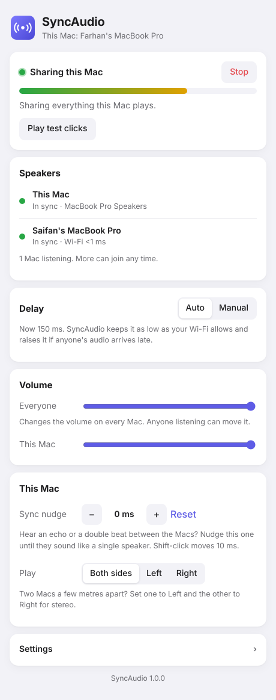
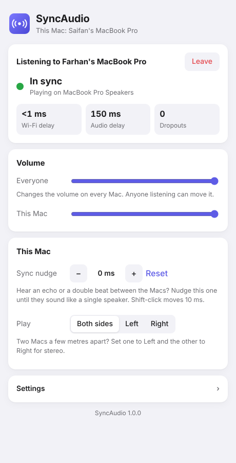

# SyncAudio

Play whatever one Mac is playing (Spotify, YouTube, a game, anything) out of
**any number of Macs at the same time, in sync**. Put two MacBooks in a room
and they sound like one bigger speaker, or like a stereo pair.

<p>
  
  &nbsp;
  
</p>

## Get it

1. **Download [SyncAudio.dmg](https://github.com/farhanhaque0619/johnschuster/releases/latest/download/SyncAudio.dmg)**.
   It's for Macs with Apple silicon (M1 or newer) running macOS 14 Sonoma or later.
2. Open the `.dmg` and drag **SyncAudio** onto **Applications**.
3. Open SyncAudio from Applications.
   * **"Apple could not verify SyncAudio…"**: click **Done**, open **System Settings →
     Privacy & Security**, scroll down, click **Open Anyway** and confirm. You only do
     this once. (It appears because the app isn't from the App Store.)
4. When it asks to **find devices on your local network**, click **Allow**.

Every Mac that plays music needs SyncAudio installed, and all of them must be on
the **same Wi-Fi**.

## Use it

**On the Mac playing the music:** click **Start sharing**.

* The first time, SyncAudio offers to install **BlackHole**, a free audio
  driver that lets it hear what your Mac plays. Click **Install BlackHole** and
  type your Mac password. Only the sharing Mac needs it.
* Click **Allow** when asked about the microphone. SyncAudio listens to
  BlackHole, never to your real microphone.
* Play anything. The bar moves when sound is coming through.

**On every other Mac:** open SyncAudio. The sharing Mac appears under
**Join a Mac that's sharing**; click **Join**. That's it. Add as many Macs as
you like, and they all stay in sync.

**Controls (each Mac has its own):**

| Control       | What it does                                                                 |
|---------------|------------------------------------------------------------------------------|
| Volume: Everyone | Changes the volume on **every** Mac at once. Anyone, sharing or listening, can move it, and everyone sees who changed it last. |
| Volume: This Mac | Only this Mac. (On a listening Mac, the keyboard volume keys work too.) |
| Sync nudge    | If you hear an echo or a double beat between Macs, nudge one until they sound like a single speaker. |
| Both / Left / Right | Put two Macs apart, set one to Left and the other to Right: real stereo. |
| Delay (sharing Mac) | **Auto** keeps it as low as the Wi-Fi allows and raises it if anyone's audio arrives late. |
| Play test clicks | Plays a metronome to check the sync by ear: one crisp click = in sync. |

When you click **Stop**, your Mac's sound goes back to its speakers.

### AirPods and headphones

They work, on any Mac, sharing or listening. Put them in whenever you like:
SyncAudio notices when macOS switches the sound to them and moves the music
over within a couple of seconds. On the sharing Mac it also keeps the sharing
going, so everyone else still hears it.

* SyncAudio never uses the AirPods' microphone, so they stay in full-quality
  music mode. (Joining a call on them switches them to call mode, which sounds
  worse. That's macOS, not SyncAudio.)
* macOS tells SyncAudio how much delay Bluetooth adds, and SyncAudio
  compensates. That estimate isn't perfect, though. If one person on AirPods
  hears things slightly early or late compared to the speakers in the room,
  use **Sync nudge** on their Mac.

## If something's off

* **The other Mac doesn't show up under Join.** Make sure both Macs are on the same
  Wi-Fi (not a guest network). Check **System Settings → Privacy & Security → Local
  Network** and turn on SyncAudio. You can also type the address shown on the sharing
  Mac into the box under the list.
* **The bar doesn't move while music plays.** Turn on SyncAudio in **System Settings →
  Privacy & Security → Microphone**, then stop and start sharing.
* **Audio drops out.** With delay on Auto, SyncAudio raises the delay within a few
  seconds. If it keeps happening, move closer to the router or use 5 GHz Wi-Fi.
  Macs also briefly pause Wi-Fi to scan for AirDrop. Running
  `sudo ifconfig awdl0 down` in Terminal on each Mac turns that off until restart,
  which often fixes repeated dropouts.
* **No sound on the sharing Mac after a crash.** Open SyncAudio again and it puts the
  sound back, or pick your speakers in **Control Center → Sound**.

## How it works

The sharing Mac captures its audio through BlackHole and stamps every 5 ms
block with the exact moment it should come out of the speakers. Every Mac,
including the sharing one, holds each block until that moment. The Macs
match clocks by pinging each other constantly and trusting only the fastest
round trips. Each Mac also corrects for its own speaker's delay as reported
by macOS. Clock drift is fixed by adding or skipping a single sample now and
then, which you can't hear.

In simulated tests with drifting clocks and jittery Wi-Fi, the Macs stay
within about 1 ms of each other. For scale, sound takes about 3 ms to cross
a metre of room.

---

## For developers

The app is `app.py` (a small local web server plus a native window) around
the engine in `syncaudio.py`, with the interface in `ui/index.html`.

**Run from source** (Python 3.9+):

```bash
python3 -m venv .venv
.venv/bin/pip install -r requirements.txt pywebview
.venv/bin/python app.py              # or: app.py --browser
```

**Build the .dmg:** pushing to `main` or `claude/dreamy-johnson-s8n24w` runs
`.github/workflows/build-mac.yml`. On an Apple silicon Mac it runs the
tests, builds `SyncAudio.app` with PyInstaller (`packaging/SyncAudio.spec`),
self-tests it, packs `SyncAudio.dmg`, and publishes it on the
[download page](https://github.com/farhanhaque0619/johnschuster/releases/latest).
The app is ad-hoc signed, not notarized, which is why macOS asks you to confirm
the first launch. With an Apple Developer account it could be signed and
notarized so that prompt goes away.

**Tests** (no audio hardware needed):

```bash
python3 -m unittest discover tests
```

They simulate Macs whose clocks and sound cards drift apart over jittery Wi-Fi,
run real sessions with three Macs over the network with simulated speakers,
and drive the app's API.

### Terminal version

The same engine works from the Terminal, without the app:

```bash
./setup.sh host                 # on the sharing Mac (installs BlackHole via Homebrew)
./setup.sh                      # on the others
./syncaudio host                # share (add --click for the metronome)
./syncaudio join [address]      # listen; finds the host by itself
```

Keys while running: `+`/`-` volume, `[` `]` nudge 1 ms (`{` `}` 10 ms),
`c` cycles both/left/right, `q` quits. `./syncaudio host --delay 250` fixes the
delay instead of choosing it automatically.
